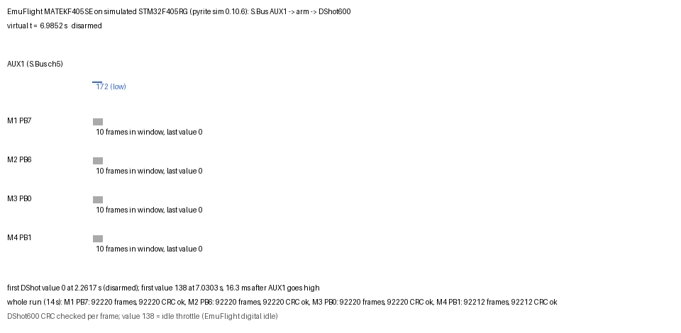

# EmuFlight on pyrite (learning pass, STM32F405RG, MATEKF405SE target)

Not for upstream. Overlay and peers are copies from
`sim-fixtures/tests/stm/matek-f405-wing` (ICM-42688P SPI1/PA4, DPS310 I2C1,
AT7456E SPI2, SD SPI3, S.Bus on USART2); `{TEST_DIR}/peers` became `PEERS`.
Sim 0.10.6, pyrite engine, JIT default.

## Target changes (src/main/target/MATEKF405SE/target.h, serial_usb_vcp.c)
- Gyro/ACC: MPU6000/6500 replaced by ICM42688P on SPI1, CS PA4 (EmuFlight has the
  driver; the Wing's IMU). INT is not wired on the Wing, so no MPU_INT_EXTI.
- `I2C3_SDA PB9` is a typo in the stock target (should be `I2C1_SDA`); the default
  I2C1_SDA is PB7, which is motor 1 (S1). Fixed here.
- `SIM_DEMO_DEVCONNECT`: calls `DCD_DevConnect` after `USBD_Init`. Needed only
  because of pyrite#4053 (OTG_FS DCTL resets to SDIS=1; RM0090 says 0).
- Build: GCC 15.2 works with `GCC_REQUIRED_VERSION` overridden (build.sh).

## Results

`make_gif.py` (`uv run --with pillow make_gif.py <rec> arm.gif`) renders it from a `--record` bundle; every number is read from the bundle.

Re-run 2026-11-22 (rebuilt, config regenerated, `--timeout 14`, `--record`): fault 0; AUX1 high in the S.Bus frame at 7.0140 s;
DShot 0 from 2.2617 s, 138 from 7.0303 s (16.3 ms after AUX1), all CRC valid on PB7/PB6/PB0 (92220 frames each) and PB1 (92212).
Armed rate 54790 frames in 6.97 s = 7.86 kHz.

| rung | result |
| --- | --- |
| 1 boot, no fault, gyro | yes. `init` at 0.0129 s, `icm426xxGyroInit` hit, scheduler runs, 0 faults |
| 2 CLI over USB CDC | yes (needs the DevConnect workaround). `version`, `status`, `tasks` answer from 2.68 s |
| 3 arm + motors | yes. S.Bus AUX1 high at 7.0 s -> armed; DShot600 value 138 (idle), valid CRC, on PB7/PB6/PB0/PB1 |

`status` (steady state, 5 s uptime): `GYRO=ICM42688P, ACC=ICM42688P`, cycle time
128-129 us, GYRO rate 7751-7812 Hz, RX rate 33, CPU 12-13%.
`tasks`: GYRO/PID 7812 Hz, ACC 950, ATTITUDE 399, RX 32, OSD 59. (An early
`status`, 4 s uptime with the first build, read cycle 278 us / 3597 Hz: not
reproduced, unexplained.)

Motor path: motor_pwm_protocol DSHOT600, TIM3 UP DMA1 s2 and TIM4 UP DMA1 s6
(DMAR burst, DCR=0x30d). Disarmed: value 0 frames from 2.26 s. Armed: 138 from
7.03 s (frame counts: see the re-run above).

Speed: 13 s virtual = 2.18 G guest instructions (168 MHz, 1 insn/cycle table),
138 s wall with `--record` (10.6 M gpio lines, motor edges) and two
`--trace-memory` watches: 63 host-ns per guest instruction, ~10.6x slower than
real time. 5 s virtual, no record: 40 s wall (~800 M insns). Host/guest
instruction ratio: not measured.

## Findings (2026-11-22)
- SD `Startup failed` was a firmware bug, now fixed here (`src/main/pg/sdcard.c`): the PG reset stored
  `spiDeviceByInstance(SPI3)` (0-based, 2) in `sdcardConfig.device`, but `spiSetBusInstance()` takes a 1-based CLI id
  (`SPI_CFG_TO_DEV(x) = x - 1`), so the card driver ran on SPI2 (the OSD bus). SPI3 registers were written once at 0.115 s and never
  again; the peer saw no SELECT. All other PG resets use `SPI_DEV_TO_CFG()`. With the fix the peer sees CMD0 (R1 0x01), CMD8 (echoes 0x1AB),
  CMD55/ACMD41, CMD58, CMD9, CMD10, CMD17 from 2.2617 s, `sdcard_reset` is never hit. The peer's CMD8 echo fix was also needed (SD PLS 4.3.13).
  `sd_info` itself was not re-run (`--preload` and `--usb-cdc-pty` cannot be combined); the evidence is the traced command sequence.
- `I2C Errors: 1` / no baro: pyrite model bug, simantic-dev/pyrite#4171. The DPS310 peer answers ID, reset, MEAS_CFG correctly; the
  firmware's 9-byte coefficient read (`bus_i2c_stm32f10x.c`, the RM0090 EV7_2 sequence) gets only 8 bytes from the model (peer `on_read`
  called for 0x10..0x17), times out after ~5 ms and re-inits the bus. Not fixable in firmware or peer without deviating from the RM sequence.

## Open
- Baro task absent until pyrite#4171 is fixed.
- `sd_info` output and a blackbox write to the card not checked (SD init now completes).
- ADC not fed: Vref 0.00 V, battery not present (as in the Wing overlay).
- `--usb-cdc-console fc.usb_otg_fs=<text>` delivered only the first line ("#");
  use `--usb-cdc-pty` (single machine only) with cli_pty.py for CLI sessions.

## Reproduce
1. `./build.sh`
2. Config: `sim STM32F405RG run --elf ef.elf --overlay <f405.run.board> --usb-cdc-pty usb_otg_fs --timeout 16 --dump-mem cfg.bin@0x08004000+0x4000`,
   then `python3 -I cli_pty.py /dev/ttysNN "aux 0 0 0 1700 2100 0 0" "save"`.
3. `./run.sh --record rec` ; `python3 -I dshot_decode.py rec` (the S.Bus peer raises AUX1 at frame 500).
